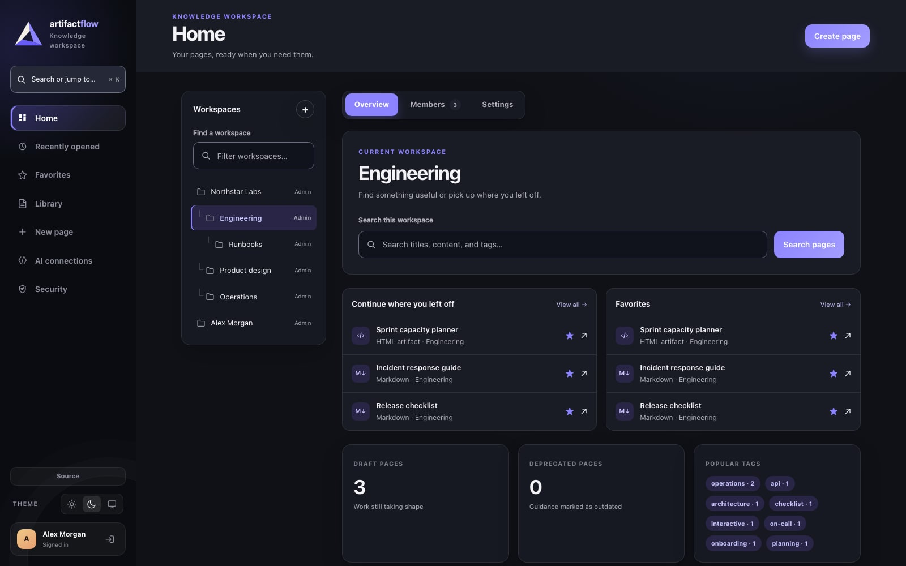
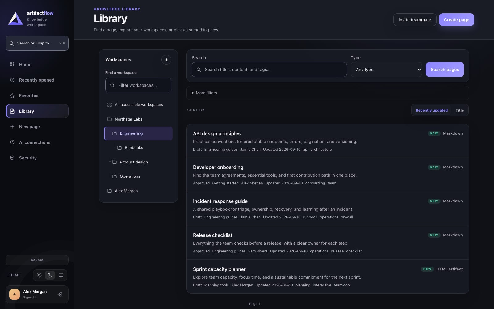
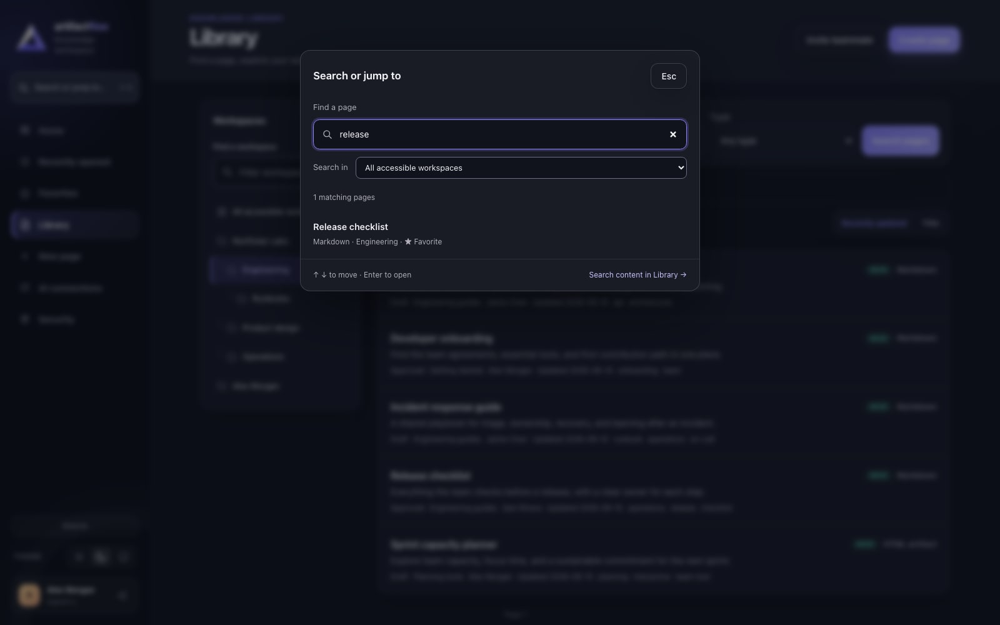
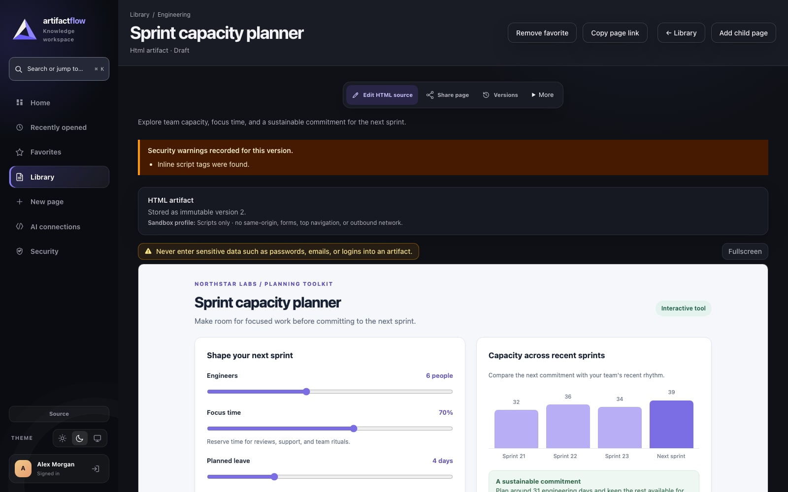
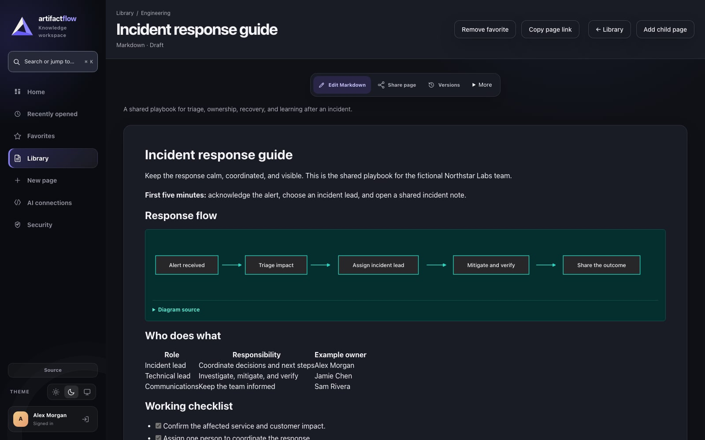

<div align="center">

# ArtifactFlow

**Keep AI-generated work useful beyond the chat.**

An open-source, self-hosted workspace to save, organize, preview, version, and share AI-generated artifacts.

[Website](https://artifactflow.app) · [How it works](https://artifactflow.app/workflow/) · [MCP](https://artifactflow.app/mcp/) · [Self-hosting](https://artifactflow.app/self-hosting/)

[](LICENSE)
[](COMMERCIAL.md)
[](#status)

</div>

For individuals, product managers, business analysts, and technical and nontechnical
teams: a shared library of useful reports, calculators, dashboards, and documents.
Colleagues use it in their browser without cloning repositories, running code
locally, or configuring publication.



Screenshots use fictional Northstar Labs content.

## Share with explicit access rules

Personal and shared workspaces offer content search, tags, categories, and previews.
Workspace roles and page-level permissions govern internal discovery and access.

External sharing is **disabled by default** and requires administrator enablement
and permission to share the page. A link exposes one artifact's current version,
without granting workspace, search, source, or history access.

- **Expiring:** multiple viewing sessions during a defined validity period. Expiry blocks new access and subsequent content loads.
- **One-time:** exactly one successful explicit redemption, not a single page view. The successful viewer can continue in their established session while authorization remains valid. There is no time-based expiration in this mode.

Both are manually revocable; the modes cannot be combined. Possession of a bearer
link does not authenticate the intended recipient. Revocation cannot retract
content already delivered. Isolated previews and format restrictions still apply.
See the [sharing contract](docs/architecture/external-sharing.md).

## One example workflow

Illustrative workflow, not adoption evidence:

1. A PM generates an interactive HTML report or calculator with AI.
2. They save it in ArtifactFlow with a workspace and tags.
3. Authorized colleagues find and use it in their browser, without Git.
4. When enabled, the PM shares it externally with an expiring or one-time link.
5. A revision becomes a retained version under the same artifact identity.
6. An authorized MCP-compatible client retrieves and updates it across AI tools.

Compare source or restore retained versions within retention limits. Stale writes
are rejected; MCP tokens have operation/workspace scopes and an Editor ceiling.

See [MCP setup](docs/operations/mcp.md) or the administrator-provided
[Claude Desktop extension](docs/operations/mcp-desktop.md).

## How this fits alongside Git

Git provides source control, collaboration, branching, and merging.
GitHub Pages provides publication; complementary services can add authentication,
private hosting, and controlled sharing. The tools can complement each other.

ArtifactFlow integrates previews, discovery, artifact permissions, controlled
sharing, retained versions, and MCP into a ready-made workflow for finished,
usable artifacts. The value is integration and accessibility, not unique features.

It is not a replacement for Git, an AI generation platform, an automatic chat
archive, a general public website host, or a fully collaborative document editor.
It does not run agents or provide simultaneous editing.

<details>
<summary>More screenshots</summary>









</details>

## Artifacts stay artifacts

| Format | What you keep and use |
| --- | --- |
| HTML | Self-contained interactive tools, with retained source and isolated previews. |
| Markdown + Mermaid | Portable documents, wiki links, and rendered diagrams. |
| PNG / JPEG | Normalized pixels; original metadata and non-pixel payloads are discarded. |
| PDF, XLSX, DOCX | Implemented, **default-off** document formats with dedicated isolated processors. |

PDF uses native-text extraction and native viewing. XLSX exposes a bounded typed
manifest and read-only grid; formulas are not recalculated. DOCX previews only an
independently validated PDF derivative. PDF and DOCX-PDF viewing is
download-equivalent. Document formats require explicit operator enablement;
DOCX also requires the PDF processor. OCR is not implemented.

## Try it locally

Requires Docker with Compose v2 and GNU `make`.

```sh
git clone https://github.com/Gadsotek/artifactflow
cd artifactflow
make up
make shell
php artisan artifactflow:install
```

Choose **local**, create the first System Admin, and exit. If configuration changed,
rerun `make up`, then `make doctor`. Sign in at [localhost:18080/login](http://localhost:18080/login).

Before enabling XLSX, run `make build-assets`; DOCX requires PDF.
Existing installations use `make migrate`. See the [operations guide](docs/OPERATIONS.md).

**The bundled Compose stack is local-only, not a production deployment template.**

## Self-hosting and security

An operator must handle deployment, maintenance, backups, and security configuration,
even when application users need no development tools.

Production requires **two separate HTTPS origins**: the authenticated app and a
cookieless artifact host. Untrusted HTML runs only on the artifact origin under
an opaque iframe sandbox and restrictive CSP. Signed preview access is
short-lived and authorization-bound. Scanning is advisory; isolation is the
security boundary.

Secure session and trusted-device cookies use `__Host-`; see the production
guide for upgrade instructions.

A sandboxed HTML artifact can still navigate itself and send embedded or user-entered data externally. WebRTC blocking is browser-dependent.
Read the [threat model](THREAT-MODEL.md).

Follow the [production operations guide](docs/operations/production.md) and
[release checklist](RELEASE-CHECKLIST.md) before inviting users.
Report vulnerabilities through [SECURITY.md](SECURITY.md).

## Documentation

- [Artifact workflow](docs/ARTIFACT-LIFECYCLE.md): identity, versions, metadata, and retention.
- [Architecture](docs/ARCHITECTURE.md) and [visual overview](docs/architecture/README.md): [system map](docs/architecture/overview.svg) · [two-origin flows](docs/architecture/workflows.svg).
- Format contracts: [PDF](docs/architecture/pdf-artifacts.md) · [XLSX](docs/architecture/xlsx-artifacts.md) · [DOCX](docs/architecture/docx-artifacts.md).
- [Roadmap](ROADMAP.md) · [Changelog](CHANGELOG.md).

## Status

**Public alpha.** Expect breaking changes and pin a revision. ArtifactFlow has
internal AI-assisted adversarial review and automated security coverage, but
has not received an independent third-party security audit.

## Contributing

Read [CONTRIBUTING.md](CONTRIBUTING.md) and [AGENTS.md](AGENTS.md). Behavior changes
start with tests. Run PHP tests only through `make test` and browser tests through
`make e2e`; both isolate their databases from development data.

`make quality-full` runs the aggregate gates, including `make type-coverage`
(100% types) and `make coverage` (PCOV, 95% line floor). Rector, Semgrep fixtures,
and applicable Compose checks also remain required as documented in AGENTS.md.

## License

[AGPL-3.0-or-later](LICENSE), with a separate [commercial license](COMMERCIAL.md).
Set `APP_SOURCE_URL` to your corresponding source URL when operating a modified
network deployment under the AGPL. See [third-party notices](THIRD_PARTY_NOTICES.md).
Contributions require DCO sign-off and the one-time [CLA](CLA.md).

Copyright (C) 2026 Gadsotek.

Agent development uses native filesystem containment for Codex and Claude Code.
See the [configuration, explicit access exceptions, and conformance checks](scripts/agent-containment/README.md).
